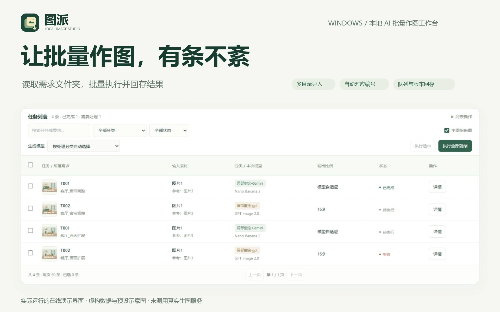

# 图派 · 造物集作品素材

产品 ID：`tupai-image-workbench`。仓库：[liaoyiming222-art/tupai-image-workbench](https://github.com/liaoyiming222-art/tupai-image-workbench)。

图派是面向 Windows 的本地 AI 批量作图工作台：读取需求目录与六字段 JSON，选择模型，转换素材引用编号，队列执行，并把结果按版本回存到各自的 `AI/` 目录。它通过 RunningHub 调用 Nano Banana 2 与 GPT Image 2.0。

## 交付与接入

| 文件 | 实际尺寸 | 用途 |
| --- | --- | --- |
| [icon.svg](icon.svg) | viewBox 64×64 | 正式矢量图标，原样沿用 `public/icon.svg` |
| [icon-512.png](icon-512.png) | 512×512 | 产品图标 |
| [hero.webp](hero.webp) | 1920×1200 | 首页展台，品牌、用途与放大的任务列表局部 |
| [card.webp](card.webp) | 1200×900 | 作品卡片，独立双行标题和能力说明 |
| [mobile.webp](mobile.webp) | 900×1200 | 手机浏览作品集时的纵向构图，不代表手机端产品 |
| [detail-01.webp](detail-01.webp) | 1920×1200 | 图片编号映射与发送提示词，对应另一项关键能力 |
| [manifest.json](manifest.json) | JSON | 产品、仓库、真实界面版本、功能边界、文件尺寸与 SHA-256 |

造物集应使用**素材提交的完整 SHA**读取这个目录，避免跟随移动分支。本目录内部、图片来源与根 README 均采用仓库相对路径；没有外站热链、个人目录或运行时下载依赖。`manifest.uiCodeCommit` 是拍摄界面的源码提交；素材本身的提交 SHA 应取 Git 历史中包含本目录的提交，二者含义不同，避免自引用。

## 界面与能力边界

- 界面来自实际运行的 `demo/public`，拍摄代码版本为 `f5a1da33ca78b2e543a782cac5fa931392cec95b`。源码哈希另见 manifest 的 `uiFiles`，按 UTF-8 LF 计算；构建程序也核对该固定提交。
- 原始截图是 [批量任务](source/batch.png)、[任务详情与编号映射](source/mapping.png)、[运行记录](source/history.png)。没有重绘、拼造任务状态或用宣传排版冒充产品 UI。
- 数据由演示版自身的 `reset()` 生成：两个虚构需求目录、四条任务、一条预设完成记录、一条模拟下载失败记录。页面中的完成数、失败数、成功率、节约时间均为示例，不能当作真实业务业绩。
- 场景缩略图是仓库原有脚本生成的 SVG 插画，不是 AI 生图效果；本次没有调用付费服务，没有接触个人 Key、真实需求文件夹或客户素材。
- 在线演示的选择目录、执行、查询、恢复与看板均在内存中模拟，刷新后重置；本地 Windows 版本才接入真实目录、RunningHub 与磁盘保存。真实模型可用性、外部服务效果和费用未在本次验证。
- `mobile.webp` 为作品集的窄屏展示单独构图，明确写有 Windows 本地工具，未使用手机安装外框，也不暗示手机端安装或生成能力。
- 本次同步示例源码并交付素材，不修改部署配置、账号权限或造物集仓库；分支推送不等同于线上演示站已部署。

## 设计与来源

沿用深绿 `#183c31`、主绿 `#32634e`、浅纸色 `#f5f6f2` 与图标浅金 `#f2e6bd`。使用中文标题、明确的字号层级、较大留白、轻阴影与圆角。正式图标保持原样；没有引入外部插画、图库或新商标。

四张图分别构图：hero 是横向展台；card 重新组织双行标题、右侧能力短语与任务局部；mobile 为纵向叙事，仅裁取桌面列表左侧局部；detail 使用深绿双栏展示完整映射详情。没有简单缩小桌面整张截图。

## 可复现制作

1. 在项目根目录运行 `node scripts/build-demo.mjs`、`node scripts/build-demo.mjs --check`、`node scripts/serve-demo.mjs`。
2. 按 [source/capture.json](source/capture.json) 中的操作、视口和矩形拍摄。原图直接保存在本目录中，因此不重新拍摄也可以重建排版。重新拍摄的日期可能不同，这是动态演示数据的正常差异。
3. 在本目录安装 [package.json](package.json) 锁定版本的开发依赖：`npm install --ignore-scripts`，然后 `npm run build`。支持 Node.js 22/24，所用 Canvas 与 Sharp 版本分别为 0.1.100、0.35.5。也可设置 `PORTFOLIO_NODE_MODULES` 指向已安装这两个依赖的目录，不改变项目运行依赖。
4. Windows 默认使用系统微软雅黑常规及粗体。其他系统设置 `PORTFOLIO_FONT`、`PORTFOLIO_FONT_BOLD` 为对应 CJK 字体路径。未随素材分发系统字体；使用不同字体可能改变字形与位图哈希。
5. `npm run verify` 检查六个正式文件的尺寸/格式、所有十张图片的哈希、正式 SVG 与产品图标一致性，以及七个实际界面源文件与拍摄提交的一致性。排版源码为 [source/build.mjs](source/build.mjs)。

构建没有网络请求。它只读取本仓库截图、图标与本机字体，用 Canvas 排版，并由 Sharp 输出 PNG/WebP。不会读取 `.local/` 或访问任何生图接口。

## 验收

- 示例生成文件与源码一致，`node scripts/build-demo.mjs --check` 通过。
- 实际浏览器验证多目录选择、导入、运行记录、看板和编号映射。浏览器无错误日志；390px 窗口没有整页横向溢出，筛选项仍可见。
- 六项正式素材尺寸和格式通过程序检查；所有图片完整解码并计算 SHA-256；实际界面源文件已与固定代码提交比较。
- 在 [展示尺寸与图标检查图](source/display-check.webp) 中按首页 960×600、作品卡片 400×300、窄屏 360×480 检查文字层级、裁切与对比。32/40px 图标分别在浅色和深绿背景检查，主体图片与星芒可辨。
- 所有宣传标题末尾无句号；模拟状态与 Windows 平台边界已标注。

素材及代码沿用项目原有权利声明，详见仓库 `LICENSE`。本目录不额外授予第三方字体或模型输出的使用权。
